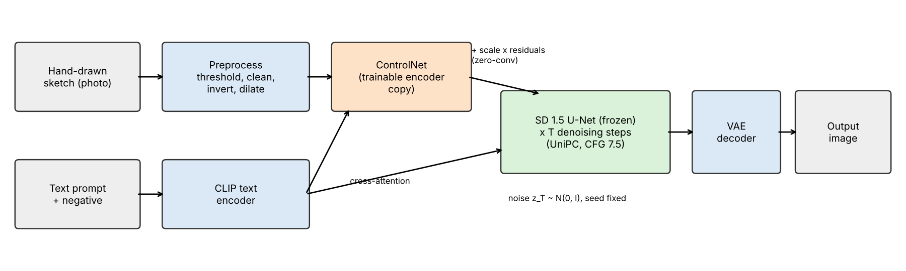

# Sketch → Image: Bringing Sketches to Life with Generative AI

Turns hand-drawn sketches into realistic images while preserving the drawn structure, using
**Stable Diffusion 1.5 + ControlNet** (Hugging Face `diffusers`). Includes a sketch-cleaning
preprocessing step, a quantitative sketch-preservation metric, a 7-experiment study, and a
Gradio web app.



## Repository structure (flat, all files at the top level)
```
preprocess.py       photo of paper sketch -> clean white-on-black control map (scribble / lineart / canny)
pipeline.py         SD 1.5 + ControlNet wrapper; swap ControlNet types without reloading SD; optional LoRA
metrics.py          edge recall / precision / F1 (sketch preservation) and CLIP score (prompt alignment)
viz.py              comparison grids
generate.py         single generation from the command line
experiments.py      experiments E1-E7 -> outputs/experiments/ (grids + metrics.csv)
app.py              Gradio UI (upload or draw a sketch, prompt, style presets, sliders)
prompts.json        subject + 3 style prompts per sketch
building.png, character.png, product.png   my input sketches
REPORT.md, pipeline.png, preprocessing.png  report draft and figures
make_test_sketches.py   synthetic placeholder sketches (testing only, writes test_sketches/)
sketch2image_colab.ipynb   run everything on a free Colab T4 GPU
```

## Installation
Needs an NVIDIA GPU with ≥ 6 GB VRAM (or use the Colab notebook). Python 3.10+.
```bash
git clone https://github.com/aimanbasharat99-cloud/sketch2image.git
cd sketch2image
python -m venv .venv && source .venv/bin/activate
pip install torch --index-url https://download.pytorch.org/whl/cu121   # match your CUDA
pip install -r requirements.txt
```
Model weights (~6 GB) download automatically from Hugging Face on first run.

## Usage
```bash
# one image
python generate.py --sketch building.png \
  --prompt "a futuristic skyscraper, glass and steel facade, golden hour, architectural photography" \
  --mode scribble --cond-scale 1.0 --seed 42 --n 2

# all experiments for the report
python experiments.py            # add --no-clip to skip CLIP scoring

# web app
python app.py                    # http://127.0.0.1:7860   (--share for a public link)
```

## Main settings (defaults used for the results)
| Setting | Value |
|---|---|
| Base model | `stable-diffusion-v1-5/stable-diffusion-v1-5` |
| ControlNet | `lllyasviel/control_v11p_sd15_scribble` (also lineart, canny) |
| Scheduler | UniPC multistep, 30 steps |
| Resolution | longest side 512, multiple of 8, aspect ratio kept |
| CFG (guidance_scale) | 7.5 |
| ControlNet conditioning scale | 1.0 |
| control_guidance_start / end | 0.0 / 1.0 |
| Seed | 42 |
| Precision | fp16 on GPU |
| Negative prompt | see `DEFAULT_NEGATIVE` in `src/pipeline.py` |
| Preprocessing | Gaussian blur 3×3 → adaptive threshold (block 31, C 10) → remove blobs < 20 px → dilate 2×2 |

## How the sketch influences the image
Stable Diffusion generates in a 64×64×4 latent space: starting from noise, a U-Net predicts and
removes noise step by step, guided by the CLIP text embedding through cross-attention. ControlNet
adds a trainable copy of the U-Net encoder that takes the sketch map as extra input. Its features
are added to the frozen U-Net's skip connections through zero-initialised 1×1 convolutions,
scaled by `controlnet_conditioning_scale`. The sketch therefore constrains *where* edges and
shapes appear, while the prompt decides *what* they look like (materials, lighting, style).
`control_guidance_end < 1` releases the sketch during the last denoising steps, which keeps
the layout (fixed early) but lets the model refine texture freely.

## Evaluation metric
**Edge recall** (with a 4-px tolerance): fraction of sketch stroke pixels that have a Canny edge
of the generated image nearby — i.e. "how much of my drawing survived". Edge precision and F1
are reported too; precision is naturally lower because realistic images contain texture edges
that are not in the sketch. **CLIP score** measures how well the image matches the prompt.

## References
- Zhang, Rao, Agrawala. *Adding Conditional Control to Text-to-Image Diffusion Models* (ControlNet), ICCV 2023. https://arxiv.org/abs/2302.05543
- Rombach et al. *High-Resolution Image Synthesis with Latent Diffusion Models*, CVPR 2022. https://arxiv.org/abs/2112.10752
- Ho, Salimans. *Classifier-Free Diffusion Guidance*, 2022. https://arxiv.org/abs/2207.12598
- Zhao et al. *UniPC: A Unified Predictor-Corrector Framework*, NeurIPS 2023. https://arxiv.org/abs/2302.04867
- Hessel et al. *CLIPScore*, EMNLP 2021. https://arxiv.org/abs/2104.08718
- Hugging Face Diffusers — https://github.com/huggingface/diffusers
- Models: https://huggingface.co/stable-diffusion-v1-5/stable-diffusion-v1-5 , https://huggingface.co/lllyasviel/control_v11p_sd15_scribble , https://huggingface.co/lllyasviel/control_v11p_sd15_lineart , https://huggingface.co/lllyasviel/control_v11p_sd15_canny , https://huggingface.co/openai/clip-vit-base-patch32
- Libraries: PyTorch, Transformers, Accelerate, OpenCV, Pillow, Gradio

## Tested setup
Verified end to end on Google Colab (Tesla T4, Python 3.13, latest diffusers), Nov 2026: single generation ~1 min including first model download, experiments E1+E3+E5 on 3 sketches ~6 min, Gradio app launches with `--share`.

## Sketches
All sketches (building.png, character.png, product.png) were drawn by me (Aiman Basharat Abbasi) for this project.

## AI assistance
Parts of the code and documentation were drafted with an AI coding assistant (Claude, Anthropic).
I reviewed, ran and modified the code, chose the experiments, and wrote the analysis myself.
