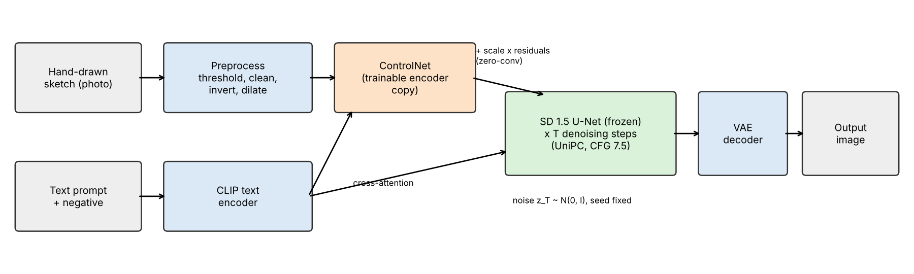
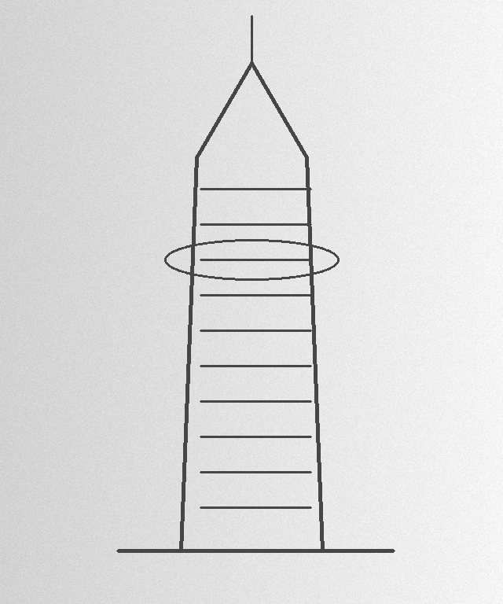
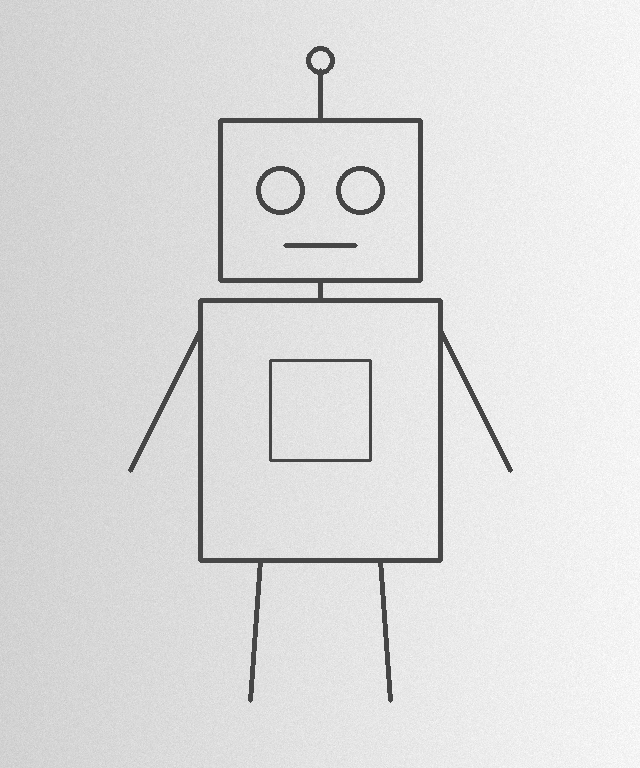
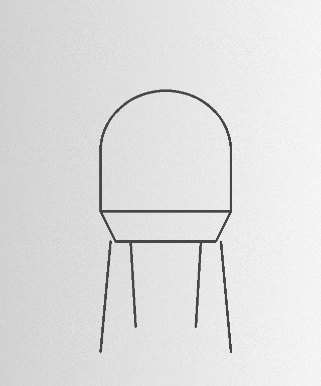

# Bringing Sketches to Life with Generative AI
**Aiman Basharat Abbasi** — MSc Biometrics & Intelligent Vision, UPEC — Generative AI, Session 2
Code: https://github.com/aimanbasharat99-cloud/sketch2image

> Fill in every `[TODO]` after running `experiments.py`. Images below link to files the
> script writes into `outputs/experiments/` (upload that folder's images to the repo, or zip it), so they show up automatically on GitHub.
> Export to PDF for submission (VS Code "Markdown PDF", or paste into Word/Google Docs). Target: 3 pages.

## 1. Goal
Generate realistic images from rough hand-drawn sketches while keeping the drawn structure. I used
three sketches of different kinds: a futuristic skyscraper (architecture), a robot (character)
and a chair (product design).

## 2. Method

**Base model.** Stable Diffusion 1.5, a latent diffusion model: a VAE compresses a 512×512 image
into a 64×64×4 latent; a U-Net learns to predict the noise added to that latent; at inference we
start from Gaussian noise and denoise for *T* steps. The prompt is encoded by CLIP and injected
through cross-attention. Classifier-free guidance (CFG) combines the conditional and unconditional
predictions, ε̂ = ε(∅) + w·(ε(text) − ε(∅)), where *w* = `guidance_scale` controls prompt strength.

**Sketch conditioning — ControlNet.** ControlNet copies the U-Net encoder, feeds it the sketch
map, and adds its outputs to the frozen U-Net's skip connections through zero-initialised 1×1
convolutions (so training starts from the unchanged SD model). At inference the residuals are
multiplied by `controlnet_conditioning_scale` (sketch strength) and applied only between
`control_guidance_start` and `control_guidance_end`. I compared three pretrained ControlNet v1.1
variants: *scribble* (trained on rough, thick user strokes), *lineart* (clean line drawings) and
*canny* (thin edge maps).

**Preprocessing.** A phone photo of a pencil sketch has shadows, paper texture and dark-on-light
lines, while ControlNet expects white strokes on black. My pipeline: grayscale → Gaussian blur →
adaptive threshold (robust to uneven lighting) → remove connected components < 20 px → dilate
(so thin strokes survive the 8× downsampling to latent resolution) → resize to 512 keeping
aspect ratio (multiple of 8). For *canny*, Canny is run on the cleaned sketch.

**Metrics.** *Edge recall*: share of sketch stroke pixels with a Canny edge of the output within
4 px (how much of the drawing is preserved). *Edge F1* additionally penalises extra edges.
*CLIP score* (ViT-B/32): prompt–image agreement. Defaults: UniPC, 30 steps, CFG 7.5,
scale 1.0, seed 42, fp16, Colab T4. [TODO: time per image, e.g. ~4 s]

## 3. Results
### 3.1 Sketch vs. generated image
| Sketch | Control map | Generated (photo prompt) |
|---|---|---|
|  | [TODO] |  |
|  | |  |
|  | |  |

### 3.2 Experiments
Mean over the 3 sketches (from `metrics.csv`):

| Exp | Setting | Edge recall ↑ | Edge F1 ↑ | CLIP ↑ |
|---|---|---|---|---|
| E1 | text only (scale 0) | [TODO] | | |
| E1 | ControlNet (scale 1) | | | |
| E2 | scale 0.3 / 0.6 / 1.0 / 1.5 | | | |
| E3 | scribble / lineart / canny | | | |
| E4 | guidance_end 0.3 / 0.6 / 1.0 | | | |
| E7 | CFG 3 / 7.5 / 12 | | | |

**E1 – Does the sketch matter?** 
[TODO: Without ControlNet the image follows the prompt but ignores the layout (low recall);
with it the outline is kept. Give the numbers.]

**E2 – Sketch strength.** 
[TODO: Expected trade-off — recall rises with scale; very high scale (1.5) can give flat,
"traced" looking images and lower CLIP score. Which value was best?]

**E3 – ControlNet type.** 
[TODO: scribble tolerates wobbly strokes and fills in plausible detail; lineart/canny follow
lines more literally, canny may produce double outlines because each stroke gives two edges.]

**E4 – When to apply the sketch.** 
[TODO: Early steps fix the global composition. end=0.3–0.6 usually keeps the shape but gives
richer texture; explain what you saw.]

**E5 – Prompts / style.** 
[TODO: Same sketch, three styles (photo / night cyberpunk / concept art): structure stays,
materials and lighting change — shows separation of "where" (sketch) and "what" (text).]

**E6 – Seeds.** 
[TODO: variation in details/colours, stable silhouette.]

**E7 – CFG.** [TODO: low CFG = washed-out / less prompt adherence; high CFG = over-saturated.]

## 4. Discussion and limitations
[TODO — examples to verify against your results:]
- Ambiguous or very sparse strokes get "hallucinated" interpretations (e.g. robot arms
  turned into cables). Thicker, closed outlines work better.
- Edge recall rewards tracing; the best-looking images were not always the highest-recall ones,
  so I chose settings by looking at both recall and CLIP score.
- SD 1.5 at 512 px limits fine detail; SDXL + ControlNet would improve quality at higher VRAM cost.
- Possible extensions: fine-tune a LoRA on a target style (the pipeline already supports `--lora`),
  or combine two ControlNets (scribble + depth).

## 5. Extras
Gradio web app (`app.py`): upload or draw a sketch, choose a style preset, tune sketch strength,
control schedule, CFG and seed; shows the control map and the edge-recall score per image.
[TODO: screenshot]

## 6. References and acknowledgement
See README for models and libraries (ControlNet: Zhang et al. 2023; Latent Diffusion: Rombach et
al. 2022; CFG: Ho & Salimans 2022; UniPC: Zhao et al. 2023; CLIPScore: Hessel et al. 2021).
Sketches drawn by me. Code drafted with help from an AI assistant (Claude); I ran, checked and
adapted it and wrote the analysis.
